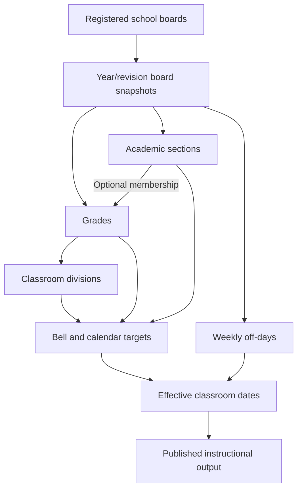

# PLAN EDU SUITE — Organization Structure Management Complete Logic Guide

**Current implemented software · 15 November 2026 · Asia/Kolkata**  
**Project:** `/Users/shreyash/Documents/Codex/plan-edu-suite`  
**Audience:** organization administrators, product owners and developers.

This guide explains the existing application. It is not a development specification, another generic audit or a comparison with Canva. All Sunrise International School scenarios below are **illustrative examples, not statements about stored school records**.

Evidence comes primarily from the current source. `STRUCTURE_MANAGEMENT_V1_FINAL_REFINEMENT_REPORT.md` and `CLIENT_PORTAL_CURRENT_STATE_AUDIT.md` were read for context; the earlier audit predates several refinements. Source behavior takes precedence where they differ. Functions and paths are cited throughout, relative to the project directory above.

**Read-only scope:** only this guide was created. No application source, existing report, configuration, tests, database, migration or functionality was changed. No application server, migration, seed, database test or browser mutation was run. Selected examples were checked using domain functions with synthetic data entirely in memory; section 15 distinguishes those checks from earlier test results and unverified browser behavior.

## 1. Executive Summary

Structure Management configures a school's academic structure for one academic year. It has exactly four primary tabs:

| Tab | Its responsibility | Main records |
| --- | --- | --- |
| School Registration | Display protected registered identity; configure the selected board's grade offerings and statuses | Institution identity; revision boards and grades |
| Academic Sections | Group grades into optional named academic sections | Sections and each grade's nullable section reference |
| Classroom Setup | Create and maintain class divisions, with organization-wide licensing | Classrooms belonging to grades |
| Bell Time & Calendar | Define school-day templates, exceptions, operational dates and instructional intervals | Schedules, calendar events and board weekly-off settings |

An academic section such as Primary is a grouping of grades. A classroom such as Grade 5A is a class division, **not a physical room**. Subject assignment, teacher workload and timetable generation are not implemented by these four tabs.

The administrator edits a **working draft**. A publication is a separate immutable snapshot. Publishing finalizes the draft and changes the academic year's current publication pointer; it does not overwrite previous publications. Viewing a historical version does not make it editable. Restoring one creates a new draft that needs review and publication.

Multiple boards can coexist in a school. Each owns its grades, sections, classrooms and weekly-off settings independently. Explicit school-wide or multi-target bell/calendar rules may span boards within the same school/year. Classroom licensing is pooled across the organization, including inactive classrooms, with maximum reservations rather than summing every snapshot/year.

For each active classroom/date, the resolver determines calendar eligibility, then selects one complete bell schedule. It does not merge selected fields from several templates. A school-specific date rule can beat a classroom-specific weekly rule because date type takes priority over target specificity. A holiday can close the date regardless of the winning bell template.

An incomplete structure can be published with warnings. Invalid schedules, broken references and effective rule conflicts are blocking errors. A missing schedule is provisional and is not a validated instructional day.

**Primary references:** `apps/web/features/structure/workspace.tsx:Structure`; `packages/domain/src/index.ts:resolve, review`; `apps/api/src/service.ts:AppService`; `prisma/schema.prisma`.

## 2. Complete Organization Administrator Journey

### 2.1 Login and initial access

1. Open the Organization portal, including the supported entry `/?portal=organization`, and sign in with the organization administrator account provisioned during Super Admin onboarding.
2. The backend verifies the password, selected portal/role and organization status. An inactive organization cannot log in or continue using its sessions. A correct password in the wrong portal still fails.
3. If `mustChangePassword` is true, the administrator must replace the temporary password before accessing workspace operations. The current/temporary field must contain the password actually used to sign in. The new password must meet the configured policy and differ from the current password.
4. Authentication creates an approximately eight-hour session. Session cookies and CSRF tokens protect workspace requests. Unauthorized/expired sessions normally return 401; missing write security tokens or a wrong Origin return 403.
5. Organization data, schools, requests, usage, workspace settings and account profile are fetched. Password changes invalidate the user's other sessions and issue a new session.

The temporary account flow is organization activation behavior. Local Super Admin credential setup is a separate administration concern; it does not configure a school's academic structure.

**References:** `apps/api/src/main.ts:login, authenticate, createSession, ApiController.handle`; `apps/web/app/page.tsx:App`; `prisma/schema.prisma:User, Session, Organization`.

### 2.2 Sidebar and school entry points

| Destination | What it displays | What the administrator does |
| --- | --- | --- |
| Overview | School metrics, structure statuses, recent academic activity and subscription/usage snapshot | Inspect attention items or go to a school/directory/account |
| Schools | Searchable school directory with list/card choices, board/account/structure filters and sorting | Open School Details; a school click here is an inspection destination |
| School Details | Identity, Academic Structure, Bell Time & Calendar and Configuration History views for a selected year | Inspect summaries, request protected changes, or deliberately enter configuration/review/calendar/history |
| Structure Management | School-selection/configuration dashboard | Select the school and start, continue or open its configuration |
| Review & History | School selection followed by draft review/publication/history workspace | Review a saved draft, inspect versions or restore a publication |
| Account & Subscription | Registered organization information and contractual allowances | Inspect contract validity/usage, change password or open registration Change requests |

Academic Years is managed inside the school workspace; it is not an extra primary sidebar module. Change requests also exists as a separate internal page, reachable from account/request workflows.

The frontend uses the main Next.js page with query/navigation state rather than a separate Next route file for every screen. Relevant parameters include `page`, `school`, `workflow`, `intent`, `year` and `revision`. A supported historical workspace URL can therefore preserve the selected school, year and revision on refresh.

**References:** `apps/web/app/page.tsx:openClientSchool`; `apps/web/features/client/portal.tsx:ClientPortal, ClientSchoolDetails`; `apps/web/lib/workspace-location.ts:useWorkspaceLocation`; `packages/domain/src/portal.ts:schoolEntryDestination`.

### 2.3 Selecting a year and entering the four tabs

A school with no academic year first needs a fresh or copied year. An existing school chooses a retained/explicit year where available. Otherwise `operationalYear` chooses a current year, then the latest started year, then the earliest upcoming year. The directory's selected-school/year override affects that school's row; it does not combine different years into one school configuration.

The workspace fetches the year's revision, configuration, current publication and organization license information. Without an explicit revision, the config API chooses the working draft first, otherwise the current publication. This matters: **ordinary School Details/config reads may show draft data** and identify that basis; the dedicated future-module published API never defaults to a draft.

Editing controls are enabled only for a loaded `DRAFT`. A published/historical snapshot is read-only. Edit Configuration creates a working draft when necessary; Return to Working Draft opens the existing draft. Selecting Edit from history is not the same as restoring that old version: explicit Restore as Draft chooses the historical source.

### 2.4 New, incomplete, active and changed schools

| Structure status | Actual meaning | Normal action |
| --- | --- | --- |
| Not Started | No selected-year structure pointer/year configuration | Start Configuration/create a year |
| Draft | A draft exists without a publication | Continue Configuration |
| Active | The current publication has no recorded publication warnings | Open Configuration; create a draft to edit |
| Incomplete Active | A publication exists with permitted warnings | Complete Missing Details; the existing snapshot remains usable with its limitations |
| Editing Draft No Changes | Both pointers exist, but logical draft content matches the publication | Continue Editing; it is not labeled pending changes solely because a draft exists |
| Draft Changes Pending | Both pointers exist and logical content differs | Review Changes or continue editing |

An incomplete-active publication is not a calendar guarantee. School Details separately calculates Bell/Calendar readiness: Requires Attention for validation errors, Incomplete for no operational classroom coverage or unresolved dates, and Configured otherwise.

### 2.5 Switching context and persistence

- **School:** loads that school's registered identity and years. It does not reuse another school's academic records. Backend ownership checks remain authoritative even if a URL is edited manually.
- **Year:** loads a distinct revision context. A year's draft/publication is not edited by changing another year. Explicit copied IDs can be stable across years, but the snapshots are independent.
- **Board:** changes the selected board inside the same full-school revision. Classroom section/grade filters reset. Draft saves still send the complete school configuration, including other boards.
- **Navigation:** retained year, board and tab selections use session storage; supported school/year/revision selections also use URL history. Unsaved-navigation guards offer stay, save or discard unsaved edits. Before unload warns about pending edits.
- **History:** revision/year URL state is restored and checked against the requested year. Historical data is still read-only. Back/Forward uses the navigation guard, rather than blindly abandoning dirty editors.

Board changes do not publish anything. Autosave saves a draft; review does not publish; only successful publication changes the active snapshot.

Editing is unavailable to organization administrators for inactive/unavailable schools, foreign organizations or inaccessible years. School Details can still inspect an owned inactive school, but configuration service access requires an active school and organization. Super Admin has separate administrative access rules.

**References:** `packages/domain/src/portal.ts:structureStatus, operationalYear`; `apps/api/src/client-portal.ts:clientSchool`; `apps/api/src/service.ts:institution, year, config`; `workspace.tsx:load, persist`; `apps/web/lib/navigation.tsx`.

## 3. School Registration — Features, Logic and Examples

### 3.1 School identity is onboarding-owned

The name, registration number, logo, address, relation officer (`officer`), phone, email and board affiliations come from the authoritative `Institution` record created/maintained by Super Admin. In this client tab they are displayed as registered information, not directly editable structure fields.

Request a Change opens a proposed protected registration change with a reason. The backend accepts a strict partial set of registration fields, requires at least one proposed field, and requires a trimmed reason of 5–2000 characters. This creates a `ChangeRequest`; it does not immediately overwrite the school. Super Admin approves/rejects a pending request with a resolution. Re-resolving an already processed request fails.

On approval, proposed values are merged with current identity and revalidated. School ownership cannot change through the request. Approved identity changes update the authoritative school. Approved **added boards** are initialized into each existing working draft, preserving other logical structures and incrementing affected revision locks. Publications/history are not rewritten. The transaction checks organization/school ownership and locks affected contexts.

A published year without a draft retains its older academic board snapshot until a new draft is created. New draft creation appends currently registered missing boards. The frontend also contains a missing-board recovery path for draft loading, but approval synchronization is not dependent solely on that frontend path.

Historical academic snapshots do not include a historical copy of every registered identity field. The identity panel reads the current school record, while the academic structure/history is revision-based.

**References:** `service.ts:institutionSchema, request, resolveRequest, saveInstitution, draft`; `workspace.tsx:School Registration panel`; `prisma/schema.prisma:Institution, ChangeRequest`.

### 3.2 Independent boards and shared rules

Each configured board has a logical board ID and owns sections, grades, classrooms, schedules/events stored on that board and its weekly-off weekday list. The board pill selects which board is being edited.

- A CBSE Grade 5 and an ICSE Grade 5 may have the same display name because uniqueness is board-local.
- A grade's stable ID cannot be moved to another board. A classroom cannot be moved to another board or parent grade under the same ID. Create a new record in the intended location instead.
- Explicit `school`, `boards`, `sections`, `grades` and `classrooms` rule scopes can span boards of this school/year. Legacy singular section/grade/classroom scopes remain board-local. Plural scopes do not grant cross-school access.
- There is **no board-active flag** in the current board model and no board-deactivation operation. Grade/classroom deactivation is supported; section activation/deactivation is not a current feature.
- Board affiliations cannot be removed once the school has any academic-year record. This restriction is broader than checking whether just that board contains classrooms. Renaming an affiliation by removing the old string is also treated as removal. With no academic years, Super Admin can approve/update affiliations subject to identity validation.
- Board names are unique case-insensitively; normalizing a name is not a migration of academic content to a different board.

### 3.3 Grade operations

| Operation | Current behavior |
| --- | --- |
| Add one grade | Enter a custom name/status. A new logical ID is created, with `sectionId: null` and no classrooms |
| Add multiple grades | Choose a numeric range, board-related selectable grade names or one custom name per line; generate a preview; remove unwanted suggestions; choose new-grade active status; commit the accepted set |
| Range | Supports Grade 1 through Grade 30, inclusive, with ordered integer endpoints |
| Bulk preview | Trims names, skips existing/repeated case-insensitive names with a reason, permits up to 100 accepted grades per operation and names up to 100 characters |
| Suggested structure | Select a board-matching preset, customize section/grade suggestions and preview impact before applying |
| Rename | Inline/form edits retain the grade ID, classrooms and target relationships; blank/duplicate names fail |
| Activate/deactivate | Per-record and selected-row operations change the grade flag; deactivation does not delete classrooms or their own flags |
| Delete | Typed-name confirmation and dependency preview; removes the grade and its classrooms from the draft and prunes rule target references |

Grades may have zero classrooms. They may also remain unassigned to sections. Unassigned grades generate review warnings, not an ownership error. A missing minimum population is not automatically a blocking error simply because the school has few/no grades or divisions.

The database has board-scoped unique constraints; the application additionally enforces case-insensitive uniqueness. Schedule/event names do not have the same blanket uniqueness rule: those are governed mainly by IDs, targeting and temporal conflicts.

### 3.4 Presets are editable starting points

`defaultAcademicPresets` contains CBSE, ICSE/CISCE, ISC, IB, Cambridge/IGCSE and state SSC/HSC starting points. Super Admin settings can supply the effective catalogue, so these defaults are not a claim about the current saved platform settings.

Important defaults:

- CBSE uses Foundation (including Grades 1–2 and early years), Preparatory (3–5), Middle (6–8), Secondary (9–12).
- ICSE uses Foundation for early years, Primary (1–5), Middle (6–8), Secondary (9–10).
- ISC has Grades 11–12 under Senior Secondary.

Applying a preset affects **only the selected board**. Matching section/grade names are reused case-insensitively. Existing grade names, statuses, IDs and classrooms are preserved. `assignExisting` controls whether reused grades also receive suggested section assignments; it defaults false. New grades use the preview's selected active status. Removing a suggestion from the preview does not delete an existing grade/section from the board. Missing target sections cause validation failure.

The simpler bulk-grade selection list is a different helper from the complete grade-and-section catalogue. It supplies candidate grade names; it does not automatically create the full academic grouping structure.

**References:** `packages/domain/src/presets.ts:defaultAcademicPresets, presetsForBoard, applyAcademicPreset`; `packages/domain/src/bulk.ts:gradeRange, gradePresets, gradePreview`; `preset-preview.tsx:PresetPreview`; `bulk-builders.tsx:BulkGrades`.

### 3.5 Sunrise International School example

Assume Sunrise is registered with CBSE and ICSE and the administrator has an editable 2026–27 draft.

1. Select CBSE. Preview a CBSE structure. Keep the default Foundation/Preparatory grouping or deliberately customize it to Primary for Grades 1–5; the software does not silently substitute that alternate grouping.
2. Apply the preview. Suppose CBSE Grade 5 did not exist: it receives a new ID, selected active status and the chosen section, but no classrooms.
3. Select ICSE and independently apply/customize its preset. ICSE Grade 5 has another ID; it is unrelated to CBSE Grade 5 despite matching names.
4. If CBSE Grade 5 already existed inactive, applying the preset does not reactivate it. Reactivate it explicitly. Checking assignment of reused grades changes its section, not its status/classrooms.
5. Create CBSE Grade 5A and Grade 5B. They belong to the CBSE Grade 5 ID. The ICSE board is unchanged.
6. **Deactivate CBSE Grade 5:** both divisions remain stored, their classroom flags remain whatever they were, section membership and rule targets remain, and both divisions become operationally inactive. Both still consume license capacity.
7. **Delete CBSE Grade 5 instead:** its two divisions are removed from the draft. Its section is preserved for other grades. Grade- and classroom-targeted rules lose those IDs; empty targeted rules disappear, while multi-target rules keep other targets. Applicable section/board/school rules survive. Pruning applies across shared rules stored on other boards too.
8. If a publication already contains those two rooms, it remains unchanged. The organization reservation may not fall until a lower-count draft is published and no other year holds the higher reservation. Before first publication, removing rooms from the only current draft can release reservation immediately after successful save.

**References:** `index.ts:removeFromBoard, removeFromConfig, resolve`; `impact.ts:assertStableOwnership`; `licensing.ts:organizationUsage`.

## 4. Academic Sections — Features, Logic and Examples

### 4.1 The section workspace

Select a board, then a named section or **Unassigned grades**. The content shows grades, their status, current section and classroom counts. A section can be created/renamed/deleted; preset suggestions can also create sections. A grade has one nullable `sectionId`, so it belongs to **at most one section in this year/board**. Sections may contain no grades and have no independent active flag.

Individual assignment uses the row's section selector. Bulk assignment uses selected grades and a destination. Add Grades shows grades not currently in that section; they may already belong to another section, so assignment is a move, not duplicate membership. Selected grades can also be unassigned.

`assignGrades` validates that every selected grade and destination section belongs to this board. The backend independently rejects invalid section references and stable-ID ownership changes. A CBSE grade cannot be assigned to an ICSE section by manipulating the selector/request.

### 4.2 Confirmation, saving and Undo

An assignment first builds a proposed board and impact preview. Confirm checks that the board has not changed since that preview; otherwise it asks for a new preview. Confirmation changes local draft state, then the normal autosave persists it.

The UI offers one-level **Undo assignment**. It restores previous section references for surviving grades, preserving their other current fields/classrooms. If a previous section no longer exists, the grade becomes unassigned; newly created grades are retained. Undo is local editor state, not a permanent database history command, and is reset on board change/remount. A subsequent confirmed assignment replaces the undo snapshot.

Impact previews distinguish record changes and potential dependent rules. An optional server calculation compares saved draft versus proposed effective classroom dates. It requires the current revision/lock; a stale preview cannot be treated as approval to overwrite a newer draft.

### 4.3 Deleting a section

Deleting Primary does not delete its grades or classrooms. Its grades receive `sectionId: null` and appear in Unassigned grades. Its ID is removed from schedule/event targets throughout the configuration; a rule targeting only Primary is removed, while a shared multi-section rule retains its remaining sections. General school/board rules and surviving grade/classroom overrides remain. Publications keep their old section membership until publication of the revised draft.

### 4.4 Moving Grade 5 from Primary to Middle

Use a customized CBSE structure with Primary = Grades 1–5, Middle = 6–8 and Secondary = 9–12. This is a valid user configuration, not the unmodified CBSE preset mapping.

| Relationship/rule | Before | After confirming move |
| --- | --- | --- |
| Grade 5 ID and board | Same CBSE grade | Preserved |
| Grade 5 section reference | Primary ID | Middle ID |
| Grade 5A/5B IDs, names, flags | Existing divisions | Preserved; no classroom duplication or new licensing consumption |
| School default | Applicable | Still applicable unless a higher-ranked rule wins |
| Primary-specific schedule/event | Can match Grade 5 rooms | Stops matching them |
| Middle-specific schedule/event | Does not match Grade 5 rooms | Now matches them, subject to rule date/priority |
| Grade 5 or 5A-specific rules | Match their stable IDs | Continue to match |
| Published version | Old membership | Unchanged until a new publication |
| Review | No proposed move | Shows membership change and dependent/potential/effective effects |

Specificity alone does not ensure a grade override beats its new section rule: the date-type rank is compared first. A Middle specific-date rule beats a Grade 5 weekly rule; a Grade 5 weekly rule beats a Middle weekly rule. Calendar holidays can also override an otherwise applicable bell template.

**References:** `section-assignments.tsx:SectionAssignments`; `impact.ts:assignGrades, configurationImpact`; `index.ts:targetRank, applicableRules, removeFromConfig`; `refinement.ts:effectiveImpact`.

## 5. Classroom Setup — Features, Logic, Licensing and Examples

### 5.1 Creating and maintaining divisions

Choose a board, optionally filter by section (including Unassigned grades) and grade, and inspect the classroom table. The shared DataTable supports text search, column filters, sorting, selected rows and pagination; inline edits commit via blur/Enter and Escape cancels the current cell edit.

- **Add classroom:** choose a grade and generate a single editable name preview.
- **Add multiple classrooms:** choose one grade or Every grade and a fixed number of divisions per grade, 1–100. Every grade means every grade in the selected board, not every school/board or merely the current section filter.
- Automatic names concatenate the full grade name and alphabetic suffix: `Grade 5A`, `Grade 5B`, through `Z`, `AA`, etc. Existing board-wide names are skipped. A grade named `5` instead generates `5A`.
- Edit proposed names, remove unwanted preview rows and choose active/inactive status before creation. The preview is paginated in groups of 10.
- Names must be 1–100 trimmed characters, unique case-insensitively across the **whole board**, not just within the parent grade. Two classrooms both named `A` in different grades of the same board are therefore not allowed; the same name on separate boards is allowed.
- The preview checks estimated available slots, validates parent grades/names again at save, and commits the accepted set atomically. Backend licensing rechecks authoritative usage under lock.
- Rename, activate/deactivate individually or activate/deactivate selected rows. A room's grade ownership is not an editable reassignment operation.
- Delete requires typed confirmation and previews dependencies. It removes only the selected room from the draft, keeps its grade and prunes room-targeted rule IDs. Multi-target rules may survive with fewer targets.

No subject allocation or physical room capacity/resource management is performed here.

### 5.2 Counts have different meanings

For the selected configuration, let `rooms` include all classrooms under all its boards/grades:

| Display concept | Exact meaning |
| --- | --- |
| Total classrooms `T` | Number of stored classroom entities, regardless of either active flag |
| Active classroom flags `A` | Number with classroom `active = true`, even when the parent grade is inactive |
| Operationally active `O` | Number with classroom active **and** parent grade active |
| Inactive classrooms `I` | Number with classroom flag false: `I = T − A`; this is not necessarily `T − O` |
| Licensed classrooms within one config | `classroomCounts(...).licensed = T` |
| Organization used/reserved | Maximum reservation formula below; may exceed the currently displayed config's count |
| Remaining organization allowance | `max(0, activeContractLimit − organizationUsed)` |

A board with 20 active classroom flags beneath an inactive grade has `T=20`, `A=20`, `O=0`, `I=0`; all 20 consume configuration/license capacity. Historical views can display old structural totals while the license banner still reflects current organization reservations.

### 5.3 Actual licensing formula

For school `s`, year `y`, let `P(s,y)` be its current published classroom count, `D(s,y)` its working draft count, and an absent pointer count as zero:

1. Year reservation: `R(s,y) = max(P(s,y), D(s,y))`.
2. School reservation: `R(s) = max(0, all R(s,y) for that school)`.
3. Organization usage: `U = sum(R(s) across all organization schools)`.
4. Remaining: `max(0, L − U)` for the unique currently valid active contract's allowance `L`.

The current policy is a **maximum count per school**, not a sum of academic years and not a deduplicated union of every classroom ID. Old historical revisions without current draft/publication pointers do not count. Inactive schools and schools pending deletion are still included by `organizationUsage` while their records remain; deactivating a school does not itself free its allocation.

The frontend estimates usage while editing: remove the selected school's previous reservation from the organization total, then add the maximum of the proposed selected year's draft/publication count and other years' reservation. This optimistic display is not the final licensing authority.

### 5.4 Limit, expiry, reduction and simultaneous requests

`assertClassroomChange` detects newly introduced logical classroom IDs relative to the prior configuration:

- No new IDs: ordinary edits/deactivations/removals are allowed even if the contract expired or the allowance was reduced.
- New IDs: require one currently valid ACTIVE contract and projected organization usage within its allowance. Splitting creation across schools/boards does not bypass the check.
- If multiple active contracts overlap, contract resolution is not guessed; creation/publication can fail with a contract conflict. The usage response reports the conflict and no single valid allowance.
- Publication separately requires a valid active contract. An expired account may save existing structure edits but cannot publish until a valid contract is available.
- Existing overage is preserved. Publishing allowed edits/reductions with an active contract can succeed with an overage warning and therefore an incomplete-active status. New additions that leave projected usage over the cap are rejected. A combined remove/add request whose final projected usage is within the cap can pass; the UI may require deleting/saving first before offering add capacity.
- Writers that increase capacity lock the organization row, then check usage and write transactionally. A second request sees the first committed reservation; concurrent schools do not independently spend the same remaining capacity.

User limits are contractual/account information. The present schema permits one organization administrator via unique `User.organizationId`; a general additional-user/RBAC management module is not present.

### 5.5 Sunrise: 70-slot organization allowance

Assume no higher-count other year exists. Sunrise's current publication/draft both contain CBSE 25 + ICSE 15 = 40 rooms. A second school's current reservation is 20:

`U = max(40,40) + max(20,20) = 60` and `remaining = 70 − 60 = 10`.

| Action, treated as an alternative unless stated | Proposed/local effect | Actual reservation result |
| --- | --- | --- |
| Add 12 to Sunrise in one commit | Sunrise draft would become 52 | `52+20=72`; entire request rejected, so no 12-room partial creation and usage remains 60 |
| Add 10 instead | Draft becomes 50 | `max(40,50)+20=70`; accepted, remaining 0 |
| Then delete 5 of those new, unpublished rooms | Draft becomes 45 | `max(40,45)+20=65`; accepted, remaining 5 |
| Deactivate 5 existing rooms from the original 60-room organization | Five classroom flags change; operational population may shrink | Counts are still 60 stored/license-consuming rooms; remaining still 10 |
| Delete 5 publication-existing Sunrise rooms from a fresh edit of its original 40-room publication | Draft becomes 35 | `max(40,35)+20=60`; draft count falls immediately after save, organization reservation does not |
| Publish that 35-room draft with a valid contract and no blockers | Current publication becomes 35 and draft pointer clears | `35+20=55`, remaining 15, provided no other year reserves more. The old 40-room historical publication remains but no longer adds usage |

**References:** `bulk-builders.tsx:ClassroomBuilder`; `bulk.ts:classroomPreview, validateClassroomPreview`; `refinement.ts:classroomCounts`; `index.ts:countClassrooms, licensedUsage, organizationUtilization`; `apps/api/src/licensing.ts:organizationUsage, assertClassroomChange, lockOrganization`.

## 6. Default Bell Schedule — Features and Mathematical Examples

### 6.1 Three areas within the fourth tab

Bell Time & Calendar contains Default Bell Schedule, Advanced Scheduling and Academic Calendar. These are internal views, not additional primary Structure Management tabs. Default templates are displayed with timeline segments, type/time labels, diagnostic highlighting and edit/delete actions. Default cards are paginated in groups of five.

The bell wizard has five steps: Select Scope, Day Timings, Fixed Routines, Configure Periods, Preview & Save. A newly created normal template initially suggests 08:00–14:30, seven 45-minute periods and no slots; these are editable suggestions, not a complete valid schedule until generated/edited. A newly requested half-day template suggests earlier dispersal.

### 6.2 Inputs and what is actually saved

| Input/control | Implemented meaning |
| --- | --- |
| Name | Nonblank template label, up to 100 characters |
| Arrival/dispersal | Minutes after midnight. Dispersal must follow arrival for a valid operational schedule |
| Day type | Full or half; half is an explicit flag, not a mathematically inferred ratio |
| Target and date rule | Which classrooms inherit this template, and on which matching dates |
| Period count | Generator input; UI supports 1–30 periods |
| Default duration | Generator input for equal-duration periods |
| Individual durations | Comma-separated duration per period; generation requires the same number of values as period count |
| Routines | Named fixed slots such as Assembly, Breakfast, Lunch, Break or custom routine |
| Period/routine slot | ID, name, kind, integer start and end minutes. The schema permits up to 100 total slots |

Period count/default duration are helper inputs for generating slots. They are not separate stored `Schedule` database columns. The persisted intervals are authoritative. Editing those helper inputs does not automatically regenerate the timeline. Existing individual durations are loaded into the helper when editing a template. A nonempty comma-separated individual-duration list takes precedence over the default duration during generation; changing only the default does not replace that list.

Only `period` and `routine` slot kinds exist. There is no independently modeled free-time/buffer kind. A transition/assembly/break that occupies time must be represented as a routine if exact coverage is required.

### 6.3 Sequential Auto Assign

`autoAssign` preserves the supplied duration order:

1. Validate a forward-moving day and positive integer durations.
2. Sort fixed routines by start; reject overlapping routines, nonpositive routine durations or routines outside the school day.
3. Begin the cursor at arrival.
4. Before each routine, place whole periods in order while they fit entirely before that routine starts.
5. A period that crosses a routine causes an error. The algorithm does not split it, shorten it or reorder later periods to fill the gap.
6. The cursor must meet each routine start exactly. Emit that routine unchanged, then advance to its end.
7. Treat dispersal as the final boundary and require every requested period to be used.

Sequential generation creates fresh period IDs/names (`Period 1`, etc.); it is not a promise to preserve existing manually named period identities. Before overwriting existing teaching slots, the UI requests confirmation. Existing routine positions are preserved.

### 6.4 Required example: 08:00–14:00 with seven 45-minute periods

Given arrival 08:00, dispersal 14:00, Assembly 08:00–08:15 and Lunch 11:15–11:45:

- Day length: `(14 × 60) − (8 × 60) = 840 − 480 = 360 minutes`.
- Teaching: `7 × 45 = 315 minutes`.
- Assembly: `15 minutes`.
- Lunch: `30 minutes`.
- Routines combined: `15 + 30 = 45 minutes`.
- Remaining: `360 − 315 − 45 = 0 minutes`.

The routine boundaries also fit the period order; aggregate equality alone would not prove that.

| Slot | Start | End | Minutes |
| --- | --- | --- | --- |
| Assembly | 08:00 | 08:15 | 15 |
| Period 1 | 08:15 | 09:00 | 45 |
| Period 2 | 09:00 | 09:45 | 45 |
| Period 3 | 09:45 | 10:30 | 45 |
| Period 4 | 10:30 | 11:15 | 45 |
| Lunch | 11:15 | 11:45 | 30 |
| Period 5 | 11:45 | 12:30 | 45 |
| Period 6 | 12:30 | 13:15 | 45 |
| Period 7 | 13:15 | 14:00 | 45 |

**Current result:** Sequential Auto Assign succeeds, with no gap/overlap/excess, and `validateSlots` returns no timing errors. This exact synthetic case was verified in memory during this documentation task. Publication still depends on the other structure, references, rules, logo, contract and revision checks.

If lunch were moved to 11:10 without changing durations, a 45-minute period would cross its start even though total minutes might still add up. Auto Assign would report the fitting problem rather than move lunch silently.

### 6.5 Assisted arrangement when sequential order fails

Use arrival 08:00, dispersal 10:10, a fixed break 09:00–09:10 and original periods P1=40, P2=60, P3=20 minutes:

- Day: 130 minutes; routine: 10; teaching: 120.
- Available teaching windows: 60 minutes before the break and 60 minutes after.
- Sequential P1 takes 08:00–08:40. P2 would cross the break, so the default algorithm fails at P2.
- Assisted arrangement finds P1 08:00–08:40, P3 08:40–09:00, Break 09:00–09:10, P2 09:10–10:10.

The synthetic case was verified in memory. The assisted function preserves the supplied period IDs/names/durations and routine positions; the UI applies a suggested order only after the administrator confirms that no pedagogical sequence is fixed. The UI constructs that supplied period set from the generator count/duration values, reusing existing period identities by index where present. If those inputs deliberately change the count/durations, preservation is relative to the newly supplied set, not a guarantee to retain every previously arranged manual period. It does not independently restore old periods excluded by a smaller generator count.

The implementation uses deterministic search with memoized failed states, a bit mask of remaining periods and pruning of equal-duration alternatives. It supports at most 30 periods and normally stops at 50,000 explored states. It distinguishes excess/missing total minutes, a proven no-fit result within its search, and reaching the safe search limit. A safe-limit result is not a claim that every possible arrangement has been exhausted.

There is no persisted per-period “must follow” constraint model. The administrator's confirmation is the current protection against violating intended teaching sequence.

### 6.6 Manual editing and fixed routines

The administrator can add/remove slots, rename them, change teaching/routine type and edit start/end times. Adding a period manually initially places it after the latest existing end and may need correction to stay within the intended school day.

The editor treats routines from an existing schedule and routines used by Auto Assign as anchored. Moving/changing/deleting these asks for confirmation. This is an editor interaction safeguard; the backend does not store an immutable routine-lock flag. New routines can be positioned before generation.

The wizard tracks unsaved schedule data and helper inputs. Saving current slots after changing but not applying generator settings requires confirmation. Canceling that confirmation leaves the editor available to generate/edit first.

### 6.7 Copying an existing template into an override

A new wizard can select **Create override from existing schedule**. It copies the complete arrival/dispersal, slot list, routine timings and day type, gives the override a new schedule ID/name and initializes a weekly date rule for further editing. Choose intended scope, dates and changes, then preview/save.

This is a complete independent template. A change to the original after copying does not flow into the override. Copied slot IDs can occur under both templates; consumers should identify a slot in its schedule context. Copying a half template does not itself create the calendar event needed to open a weekly closure.

### 6.8 Draft saving versus operational validity

The UI shows `scheduleDiagnostics`: gaps, all detected overlap pairs, nonpositive durations, out-of-bound intervals and invalid day lengths. The save action parses the schema, requires appropriate selected targets, sorts slots chronologically and commits the template to the draft. Timing diagnostics may remain: an incomplete/gapped template can be saved as a draft.

The backend enforces schema shape, bounds, references, duplicate IDs/names, ownership, locks and licensing during draft save. Temporal coverage validation is deliberately deferred. At publication, **every stored template** is timing-validated, even one not currently winning for any classroom. Invalid durations, overlap, gaps, out-of-hours timing or incomplete arrival-to-dispersal coverage block publication.

A valid schedule must exactly cover the whole day with positive, non-overlapping slots. Merely making teaching minutes plus routine minutes equal the day length is insufficient if intervals overlap or lie in the wrong positions. Conversely, a full routine-only exact-coverage template is not rejected by a separate “at least one teaching period” rule: no such minimum is imposed in `validateSlots`. “Validated instructional date” here means a valid resolved operational template, not a guarantee of positive teaching minutes, subjects or staffing.

**References:** `schedule-wizard.tsx:ScheduleWizard`; `index.ts:autoAssign, validateSlots, scheduleSchema`; `enhancements.ts:scheduleDiagnostics`; `refinement.ts:assistedAssign`; `workspace.tsx:commitConfiguration`; `service.ts:saveConfig, publish`.

## 7. Advanced Scheduling — Inheritance, Priority and Conflicts

### 7.1 Targets and ownership

A rule is stored once on an owner board within a revision. The owner is a storage location; applicability is determined by its target plus the shared-scope rules.

| Scope | Applies to | Specificity score |
| --- | --- | --- |
| School | Every matching classroom across all boards of this config | 1 |
| Board | Current owner board | 2 |
| Selected boards (`boards`) | Listed board IDs in the school/year | 2 |
| Section/selected sections | Classrooms whose parent grade belongs to a listed section | 3 |
| Grade/selected grades | Classrooms under listed grades | 4 |
| Classroom/selected classrooms | Listed classroom IDs | 5 |

The UI supports searchable multiple selections. Plural section/grade/classroom scopes can explicitly target several boards. Singular legacy forms remain confined to the owner board's IDs. A rule with no matching target contributes nothing to the ranking. A selected-target rule cannot have an empty target set in a valid configuration. School/board scopes legitimately have no explicit IDs.

Moving a grade changes its inherited section rules immediately in the proposed draft, without changing room identities. Grade/classroom target overrides continue matching their own IDs, subject to date rank. Renaming a section/grade/classroom changes labels, not ID-based targeting.

### 7.2 Date patterns and their exact meaning

| Rule type/control | Meaning |
| --- | --- |
| Default | Matches every date within any configured bounds; weekly closure/holidays are still resolved separately |
| Weekly | Matches any selected weekday |
| Recurring | Selected weekdays, optionally one first–fifth occurrence and/or every-N-week interval |
| Specific date | Exactly one real ISO date |
| Starts/ends | Inclusive optional boundaries; dates outside are excluded |
| Inclusive range option | A bounded recurring rule selecting all seven weekdays; no separate holiday-range table |

Weekdays use Sunday=0 through Saturday=6. For a matching weekday, occurrence is `ceil(dayOfMonth / 7)`: days 1–7 are first, 8–14 second, 15–21 third, 22–28 fourth, 29–31 fifth. It is the nth occurrence of each selected weekday, not the nth working day of the month.

Only one nth value is stored per rule. **Second and fourth Saturdays normally require two rules**, one with nth=2 and one with nth=4. A nonexistent fifth weekday has no matching date and creates no synthetic closure.

For interval `N > 1`, an anchor is required:

`deltaDays = floor((dateUTC − anchorUTC) / 86,400,000)`  
`matchesInterval = deltaDays >= 0 AND floor(deltaDays / 7) mod N = 0`.

This is an anchor-based sequence of seven-day blocks, not necessarily ISO calendar weeks. With a Monday 2 November 2026 anchor and every two weeks on Monday, 2, 16 and 30 November match. An anchor on another weekday shifts the seven-day blocks. Bounds restrict matches independently; they do not automatically rebase the anchor. The nth and interval tests, when both configured, must both pass.

UI nth/interval controls are shown for recurring rules. The core matcher can also evaluate corresponding supplied fields on a weekly rule; display labels are not a separate runtime algorithm. A recurring rule without nth/interval restrictions can match the same dates as a weekly rule but still has the higher recurring date-type rank.

### 7.3 The priority calculation

`priority = dateTypeScore × 10 + targetSpecificity`:

| Date type | Score | Possible matching priorities |
| --- | --- | --- |
| Default | 0 | 1–5 |
| Weekly | 1 | 11–15 |
| Monthly/interval recurring | 2 | 21–25 |
| Specific date | 3 | 31–35 |

The date-type ranges do not overlap. A school date exception (31) beats a classroom recurring rule (25). Within the same date type, classroom beats grade, grade beats section, section beats board, board beats school. A single-classroom and a plural selected-classrooms rule have the same specificity if both target that room.

Only matching date/target rules enter the candidates. The highest schedule priority wins as **one entire template**, including day type, arrival/dispersal and all slots. There is no “override only dispersal and inherit all periods” runtime operation.

Two or more schedules tied at the highest applicable priority cause conflict, even if they have identical timings. The resolver does not choose newest-created. Lower-ranked bell collisions do not defeat a strictly higher winning schedule for that date, although malformed stored templates can still block global publication validation. The duplicate-template hint identifies matching bell content for manual review, not proof that scopes/dates are redundant and not automatic consolidation.

### 7.4 Required Grade 5A overlap example

Assume Grade 5 belongs to Primary and all templates have internally valid slots. Use **Monday 9 November 2026**, the second Monday:

| Applicable schedule | Rank |
| --- | --- |
| School default, 08:00–14:00 | `0×10+1 = 1` |
| Primary weekly Monday, 08:00–13:00 | `1×10+3 = 13` |
| Grade 5 recurring second Monday, 09:00–12:00 | `2×10+4 = 24` |
| School-specific date 9 November, 08:30–11:30 | `3×10+1 = 31` |

**Winner:** the complete school-specific-date 08:30–11:30 template. Its broad school target does not make it lose to a narrower recurring rule because date type is compared first. No slots are inherited from the other three templates.

Now add a full holiday for 9 November targeting the school. The effective date becomes **holiday**, with no operational bell template/teaching intervals. The previously winning bell rule does not reopen it.

To reopen just 5A, an explicit classroom-specific working exception for 9 November with `overridesHoliday=true` has rank 35, strictly above the school holiday's 31. It can reopen 5A if an appropriate valid schedule is available; other classrooms remain closed. A school-specific working exception tied at 31 conflicts with the school holiday even if its checkbox is authorized. A higher-ranked ordinary working exception without the explicit authorization still cannot defeat a full holiday.

### 7.5 How the interface explains the winner

Advanced Scheduling lists rule name, selected target names, recurrence/weekday/nth/interval/boundary/anchor details, action and local validation status. Its precedence notice explains date-type and scope order.

The classroom date preview shows effective status, selected schedule name, reason, times and slots. Working reasons include the winning template, full/half type and rule type/scope, with reopening explanation when relevant. The resolver also provides structured winning-rule identity/priority for consumers. An advanced-row “Ready” label is mostly local timing/event information; it is **not** a substitute for full-year conflict validation.

**References:** `index.ts:matches, targetRank, ranked, applicableRules, resolve`; `scope-rule.tsx:ScopeRule`; `calendar.tsx:BellCalendar`; `refinement.ts:duplicateTemplates`.

## 8. Academic Calendar — Conditions and Calculations

### 8.1 What the administrator configures

Academic Calendar uses the selected year's start/end and the selected board's weekly non-working weekday list. New boards default to Sunday off; this is editable in a draft. Dates not marked off are potentially operational, subject to calendar events and schedule validation.

The event editor supports a title, holiday/working/half-day type, target scope/multiple IDs and date rule. A direct inclusive holiday range sets all seven weekdays with start/end bounds. For **Winter Vacation — 24 December 2026 through 2 January 2027**, the inclusive range has ten dates. Both endpoints count, including any Sundays inside it, but each date closes only once.

The frontend event editor rejects event date/bound endpoints outside the year. Rule schemas validate real dates and ordered bounds, and preview endpoints reject out-of-year requested dates. The general draft-save service does **not** impose that same UI year-containment check on every stored rule date/bound: a raw valid out-of-year rule can be stored but simply may not match the reviewed year. This is a current validation distinction, not a claim of identical checks at all layers.

Editing/deleting an event changes the working draft, never an old publication. Weekday toggles use draft autosave; explicit Save Event commits the proposed configuration. Changing event type away from Working clears holiday-reopening authorization in the editor.

### 8.2 Operational resolution order and event conditions

For one classroom/date, `resolve`:

1. Rejects an invalid date or a classroom not under this board.
2. Returns **inactive** if the grade or room flag is false.
3. Collects applicable events/schedules from this board and explicit shared scopes of other boards in this config.
4. Finds highest applicable holiday and working exceptions. Equal-ranked contradictory holiday/working exceptions conflict.
5. A full holiday closes the date unless the highest working exception is a specific-date explicitly authorized reopening with strictly higher priority. An ordinary working/half-day bell schedule does not defeat it.
6. Finds a half-day event; equal-ranked half-day and full working events conflict.
7. A regular weekly off-day remains closed unless an applicable working or half-day **event** opens it. A bell schedule alone cannot open it.
8. Determines whether a half-day event still applies after a higher-priority working exception, then chooses a bell template. No schedule returns **missing**, with an explicit expected full/half day.
9. Equal highest schedule ranks return **conflict**. Invalid selected intervals return **invalid**.
10. An effective half-day event requires a half-type schedule at the **same or higher combined priority**; a lower-priority half default is insufficient even if its timing looks short enough.
11. Otherwise returns working with the selected full/half template and explanation.

The highest working event is the reopening candidate; the engine does not search lower working rules to find a more convenient authorization. Identical/same-kind holiday entries can overlap without deducting a date twice. Full holidays suppress ordinary half-day operation; they do not create a half operational day.

### 8.3 Full day and half-day do not mean a fixed number of hours

There is no required positive minimum number of weekly working days. A board can mark all seven weekdays off; working events can still reopen dates. A calendar with active classrooms and all dates validly closed can have no unresolved dates and appear Configured while exposing zero instructional minutes.

A valid half-day schedule is explicitly marked half and has its own exact-covered intervals. There is no automatic “must be at most half the default duration” constraint. Half-days count as one working date, separately identified as half-days; they are not converted to 0.5 in day/week totals. Their actual instructional minutes come from their teaching intervals.

A full-day schedule does not become a half-day automatically because its dispersal was shortened. Set the template's day type and supply an appropriately ranked matching schedule when a half-day event applies.

### 8.4 Exact formulas and source functions

For an active classroom and inclusive UTC range `[start,end]`:

| Requested quantity | Implemented formula/condition | Source |
| --- | --- | --- |
| Total calendar dates `N` | `floor((Date.parse(end) − Date.parse(start)) / 86,400,000) + 1` | `calendarSummary` |
| Validated instructional dates `V` | Count resolved `working` dates with a valid full/half template | `resolve`; `calendarSummary.validatedWorkingDays` |
| Provisional working dates `P` | Count `missing` schedule dates, including unresolved expected half-days | `calendarSummary.provisionalWorkingDays` |
| Calendar working dates `W` | `V + P`; returned as legacy-compatible `workingDays` | `calendarSummary` |
| Full instructional dates | `V − validHalfDays` | `fullWorkingDays` |
| Half-days | Working dates whose selected template has `dayType='half'` | `halfDays` |
| Closed dates `H` | Count status holiday OR weekly non-working, once per date | `holidays` |
| Invalid/conflicting dates `C` | Count status invalid OR conflict; one shared counter | `conflictingDays` |
| Unresolved dates `U` | `P + C` | `unresolvedDays` |
| Regular weekly working days | `7 − number of distinct weekly-off weekday values` | `regularWeeklyWorkingDays` |
| Observed working days per week | For complete Monday–Sunday buckets only, common calendar-working count if identical across those buckets; otherwise null, also null if no complete bucket | `workingDaysPerWeek` |
| Working weeks | Number of Monday-based buckets with at least one calendar working date, including partial first/last buckets | `workingWeeks` |
| Available instructional minutes on one valid date | Sum `slot.end − slot.start` for teaching (`period`) slots only | `publishedOutput`; intervals selected by `resolve` |

For each active classroom, `N = H + V + P + C = H + W + C`. Invalid/conflicting dates are not quietly included as validated instruction or holiday deductions. A missing schedule is included in calendar working dates but not full/half validated instructional counts. Since working-week calculations use `W`, they may themselves be provisional. The summary's `provisional` flag is true when any included classroom has unresolved dates.

Annual rows include only rooms with both flags active. Inactive rooms can appear as inactive in date previews but do not contribute annual operational calendar rows. With no operational rooms there is no common classroom total; the absence of rows is not proof of a complete calendar.

No school-level sum of classroom-days is called a number of school working dates. Most common totals are shown only if per-date classifications match for every included room. Those signatures distinguish closed, full, half, missing-full, missing-half, invalid and conflict, while ignoring holiday wording. The regular weekly-days field has its own numeric agreement check.

**Source functions:** `packages/domain/src/enhancements.ts:calendarSummary, calendarDay, selectedClassrooms`; `packages/domain/src/index.ts:resolve`; `packages/domain/src/published-output.ts:publishedOutput`.

### 8.5 Required calendar examples

**Example 1 — Holiday overlaps Sunday.** In Monday 16–Sunday 22 November 2026, with Sunday off and valid schedules Monday–Saturday, `N=7`, `V=W=6`, `H=1`. Add a holiday on Sunday 22 November: `H` stays 1 and `W` stays 6. Two overlapping holidays on the same Sunday still close one date. The engine resolves the date once instead of separately subtracting every matching record.

**Example 2 — Second/fourth Saturday and missing fifth.** November 2026 Saturdays are 7, 14, 21 and 28. nth=2 closes 14; nth=4 closes 28. No fifth Saturday is invented. January 2027 has 2, 9, 16, 23 and 30, so nth=5 matches 30 January. February 2027 has 6, 13, 20 and 27 and therefore no fifth match. These date sets were checked in memory. If all Saturdays are already weekly off-days, these holiday rules do not deduct additional dates. If Saturdays are normally working, only matched closures change their eligibility.

**Example 3 — Half-day.** Suppose a classroom-specific date half-day event has rank 35. A valid classroom-specific date half template (also 35), for example 08:00–11:00 with exact slots, gives one validated working date and one half-day, zero full instructional dates. With no matching schedule, the result is missing/unresolved-half: one provisional calendar working date, zero validated/half/full instructional days. With a full template selected, or a lower-priority half template, the result is invalid and publication is blocked. With two top equal-ranked bell templates, resolution conflicts before picking a convenient half schedule. Without a controlling half-day event, competing full/half templates follow the ordinary priority/tie rules; a lower full default can be overridden by a higher half template on an already operational date.

**Example 4 — Authorized reopening.** A recurring school holiday at rank 21 can be reopened for one classroom by a date/classroom working event at rank 35 with explicit authorization. The editor asks for deliberate confirmation and the save writes a reopening audit entry. A valid full schedule gives one validated date; a missing schedule gives only a provisional date; an invalid/conflicting schedule remains unresolved and cannot be published as valid operation. A plain weekly off-day can also be opened by a special working/half-day event; full-holiday authorization is specifically required to defeat a full holiday. A lone date bell template does not open either closure by itself.

**Example 5 — Mixed calendars.** Assume Grade 3A has 200 validated working dates including 10 half-days and Grade 3B has 200 including 15 half-days. Their full instructional counts are 190 and 185. Their daily signatures differ. School-level `mixed=true`; the common working/half/full/working-week aggregates are conservatively suppressed as null/Varies rather than inventing a common 200-day calendar, adding them to 400 or averaging them. Per-classroom rows retain each count. Different half-day dates with equal annual half-day totals also produce mixed calendars. Different holiday descriptions on identical closed dates do not.

**Example 6 — Missing bells.** For 16–22 November with Sunday off and no schedules, the in-memory engine returns `N=7, W=6, V=0, P=6, H=1, fullWorkingDays=0`, one working-week bucket and observed six calendar working days in the complete week. The summary is provisional. The six dates are eligible calendar dates, not six confirmed instructional days.

### 8.6 Calendar views and preview limits

Monthly Calendar supports month grid and resolved day list, bounded by the academic year. Selecting a day opens classroom date details. Filters narrow section, grade and classroom. Year Summary can use selected board/target filters or the entire school; entire-school scope deliberately ignores narrower board filters. The per-classroom table shows working, holiday, validated, provisional, invalid/conflict, half-day, working-week and unresolved counts. Selecting a single room also shows its holiday-date/reason list.

- **Pattern Preview:** returns dates matching only the rule pattern within the year, paginated 12 at a time. A default pattern can include Sundays even though the effective calendar closes them.
- **Effective Calendar Preview in editors:** injects the unsaved proposed rule/template into the full configuration, allows selection of a preview board and resolves its first 12 matching pattern dates. It is a sample, not complete-year validation. Changed input invalidates previous editor preview results.
- **Classroom date preview:** resolves a chosen in-year date against all rules; details show status/reason and the selected slots, paginated 10 rooms at a time.
- **Backend preview:** accepts 1–32 requested in-year dates. The monthly UI combines month dates and selected date within this bound.
- **Annual review/publication:** checks the complete year, not just the first 12 editor preview dates.

The calendar target filter has All Sections and named sections but no explicit Unassigned-only option comparable to Classroom Setup. Some broad rule lists can display shared rules whose targets lie on other boards when no target filter is applied; actual date resolution still checks applicability. A row's existence/local Ready label does not prove it wins for this classroom/date.

## 9. Academic-Year Management

### 9.1 Creating a fresh year

Manage Academic Years lists the selected school's years and opens a year-creation workflow. Enter a label, start and end. The label must be unique within the school. Dates must be real ISO dates and end strictly after start. The actual check permits `end − start <= 550 days`, which means up to **551 inclusive dates**, despite the message saying “at most 550 days.” A same-day start/end year is rejected.

Fresh creation initializes each currently registered board with Sunday off and no sections, grades, classrooms, schedules or events. It creates an AcademicYear, sequence-1 draft Revision and draft pointer transactionally. It does not create a publication, promote pupils or populate subjects.

### 9.2 Copying a previous year

The copy source must be a year of this same school. When it has a current publication, that is the source even if it also has an edited draft. Only when no publication exists does copying use its draft. Therefore unsaved/unpublished changes in a published source year do not automatically transfer.

| Source content | Current copying behavior |
| --- | --- |
| Boards, sections, grades and classrooms | Deep-copy their academic structure, names, flags, assignments and logical IDs |
| Weekly-off settings | Copied |
| Default/weekly/recurring unbounded rules | Copied unless the interval option excludes them |
| Specific-date schedules/holidays/events | Excluded, not shifted by one year |
| Any date-bounded schedule/event | Excluded, even if otherwise recurring |
| Interval recurrences | Keep old anchor, exclude interval rules, or rebase to new start date according to the selected option |
| Newly registered boards absent from the source | Added as empty board configurations |
| School registration identity/contracts/accounts | Not duplicated as independent records |

Grades do not automatically advance: copied Grade 5 remains Grade 5. Copying does not change the old year/publication. Stable IDs permit relationships to survive within the copy, while physical snapshot rows are independent.

The copy screen previews counts and categories and recalculates inclusion counts when anchor options change. Its preview is not a complete new-year effective-date simulation. Actual rebase is performed on the backend using the entered **new** start date. Keeping an old anchor can change which dates match compared with rebasing; review the new year's Pattern/Effective Calendar Preview.

A copied year with classrooms also passes classroom-creation licensing checks. Even if maximum reservation prevents double charging, creation containing rooms requires a valid active contract under `assertClassroomChange`; a fresh empty year has no classroom additions.

### 9.3 Overlaps and boundaries

A new year's range is compared inclusively with existing years of the same school under the school lock. Sharing an endpoint is an overlap. Without a deliberate exception reason, the request is rejected. The organization administrator can supply a 10–1000-character overlap reason; it is recorded in the creation audit with the overlapping years. This is not an extra Super Admin approval workflow. Existing years are left unchanged.

Current UI/service expose creation and opening contexts, not a general edit/delete-year operation. Calendar event date controls do not edit the academic year's start/end. Independent year context also does not imply summed licensing: section 5's maximum reservation remains the actual policy.

**References:** `academic-year.tsx:AcademicYearForm`; `service.ts:years, createYear`; `index.ts:copyYear, emptyConfig`; `refinement.ts:copyRuleClassification`; `prisma/schema.prisma:AcademicYear`.

## 10. Drafts, Review, Publishing and History

### 10.1 Where a working draft lives

A year has at most one current draft pointer and one current published pointer. A revision holds board/section/grade/classroom snapshots and schedule/event JSON fields. Unsaved editing also exists temporarily in browser memory, but successfully saved drafts are database records.

Ordinary grade/section changes, inline renames/statuses, section moves, deletion and weekly-off toggles update the local full-school config. The workspace waits approximately one second after dirty state changes before saving. Explicit Save Draft also triggers persistence. Saves are serialized; returned locks/license information update the editor. Navigation/review attempts ensure pending parent saves finish.

Bulk grade/classroom creation, preset application and explicit schedule/event Save actions use explicit commit paths rather than waiting only for debounce. The schedule/event editor can hold an unsaved proposed item until Save. Not every field keystroke is therefore immediately a database write.

### 10.2 IDs, locks and transactions

`Revision.id` identifies a particular draft/publication snapshot. `Revision.lock` is a numeric optimistic lock incremented on successful draft saves and affected affiliation synchronization. The current frontend supplies both. Older API clients may omit the revision ID but still must supply the numeric lock; a number alone is weaker at distinguishing replacement drafts with coincidentally equal lock values.

When a current request includes both identity and lock:

- Wrong/replaced revision → conflict; reload before saving/discarding/publishing.
- Same revision but stale numeric lock → conflict; no silent last-writer-wins overwrite.
- Current tokens → transaction validates/writes, then increments the lock.

Organization/year/school row locks coordinate applicable writers and licensing. Optimistic locks protect the complete draft, not just one edited row, so two browser sessions editing different boards can still conflict. There is no automatic merge or real-time co-editing presence system. The current account schema also does not provide a multi-admin client RBAC module; concurrent browser sessions/requests can nevertheless occur.

### 10.3 Review: what is compared and validated

Review compares the saved working configuration with the current publication by stable logical IDs. It reports added/deleted/updated board, section, grade, classroom, schedule and calendar-event records and changed fields, with labels for readable context. A new first draft is compared against no publication.

Validation checks schema/reference/ownership/naming and all stored schedule templates, then effective resolution across dates/classrooms. Potential dependency impacts are listed separately from exact effective comparisons. The effective signature includes status, selected schedule ID/day type, arrival/dispersal and slot IDs/kinds/intervals; it is an academic dependency comparison, not a claim that every counted difference changes teaching minutes. A renamed grade can produce record changes with zero effective changed dates; changing an interval/schedule identity can produce effective changes even if minute totals are equal.

Blocking errors include duplicate names/IDs, invalid section/target references, malformed templates, gaps/overlaps and effective conflicts/invalid half-day matching. Permitted warnings include unassigned grades, missing bell coverage on working dates and existing contract overage. The standalone domain review has a supplied-limit check; the service passes an effectively unlimited local count and applies organization licensing separately, so it does not enforce a hidden board-specific license.

There is **no blanket blocking minimum of grades/classrooms or required default template**. A logo-bearing school with an active contract and empty registered-board structures can have no generated review warnings and publish Active, while School Details still reports its calendar Incomplete due to no operational rooms. Empty setup is not proof of readiness. All stored templates are validated even if unused/inactive; some contradictory holiday/working checks also remain separate from the inactive-room early exit.

### 10.4 Publishing and preserving old versions

Publish requires a saved draft, matching revision/lock, a valid active organization contract, a nonblank publication summary up to 1000 characters, the required school logo and no blocking review errors. Review also checks school name/registration; those are required on authoritative registration creation/update.

Inside the publication transaction, validation is performed again. A preceding successful review is not permission to publish a newer unreviewed draft: a stale lock fails. The draft's status becomes `ACTIVE` if there are no issues, otherwise `INCOMPLETE_ACTIVE` when only permitted warnings remain. The same revision receives summary, warnings and publication time. The year points to it as current publication and clears the draft pointer. Older published revisions are preserved.

Publication logs record previous/new revision IDs, changes, stable affected entities and calculated effective dates. There is no external broker/webhook delivery system. A permitted overage warning can make a publication incomplete-active even when its bell coverage is otherwise valid.

### 10.5 Required 2026–27 edit scenario

Assume version A is Sunrise's published 2026–27 configuration:

1. **Create a working draft:** clone A into a new revision B with the next sequence. A remains current active publication.
2. **Edit Grade 5:** a rename preserves IDs; a status change alters operational classrooms; deletion removes draft rooms/targets. Only the draft changes.
3. **Change a bell schedule and add a holiday:** explicit editor Saves commit complete templates/events to B; regular structure edits autosave. Future-module published reads still return A.
4. **Review:** compares A with B, explains records/dependencies and validates dates/templates/targets. The holiday can alter effective working dates even if grade names are the only structural change.
5. **Validation fails:** B remains a saved editable draft, A remains active, no partial new publication occurs. Correct the draft and review again.
6. **Another session saves first:** the old lock cannot publish or save over that work. Reload and review the latest B; no automatic merge is attempted.
7. **Publish succeeds:** B becomes current publication, marked Active or Incomplete Active as appropriate; draft pointer clears. A remains in history.
8. **New active reads:** published-output returns B's revision ID. Consumers can invalidate results based on that identity change.

### 10.6 History and restoration

History lists non-Draft revisions with sequence, summary, status, publication date and warnings. View fetches the exact revision constrained to this year; supported URL state retains school/year/revision on refresh. The snapshot's editor controls remain read-only. Opening a history view does not replace current publication.

Restore as Draft requires no existing working draft and a same-year non-Draft source. It creates a new revision, copies that snapshot's academic data, adds any now-registered missing boards and checks licensing. The old version remains unchanged; the restored draft must pass review and be published before it becomes active. Historical configurations containing extra classroom identities may require valid capacity/contract to restore.

### 10.7 Two different discard actions

| Action | What it discards | What it does not undo |
| --- | --- | --- |
| Discard Unsaved Changes during navigation | Local/editor edits not committed to the server; parent guard waits for an in-flight save then reloads stored config | Changes already autosaved; current publication/history |
| Discard Working Draft | Deletes the current draft snapshot and clears its pointer after matching tokens, returning to the existing publication | Current/old publications and the academic-year record |

The draft-discard API requires both a draft **and an existing publication**. It cannot delete an initial unpublished setup through that action. No Reset Initial Draft operation is implemented. Autosave means that closing a page and selecting Discard Unsaved Changes does not roll the entire working draft back to its publication; already saved changes need the distinct working-draft discard operation.

**References:** `workspace.tsx:persist, ensureSaved, commitConfiguration, change`; `apps/web/lib/navigation.tsx`; `apps/web/lib/navigation-core.ts:settleNavigationGuards`; `service.ts:saveConfig, review, publish, history, draft, discard`; `store.ts:writeConfig`.

## 11. Cross-Tab Data Flow and Dependencies

### 11.1 Relationships

The diagram describes data relationships, not an automatic sequence that publishes edits. Rules and operational dates belong to a school/year revision; future consumers see them only through the publication they read.

### 11.2 Rename, move, deactivate and delete effects

| Record/action | IDs/data preserved | What changes downstream |
| --- | --- | --- |
| School identity approved rename/contact/logo change | School identity and academic snapshots remain distinct | Current identity displays update; historical academic snapshots are not historical identity panels |
| Registered board added | Existing academic IDs/publications | New empty board added to drafts; draft locks advance; school-wide rules can later apply to its new classrooms |
| Registered board removed/renamed after years exist | Existing registered affiliation/history protected | Request/update rejected; there is no automatic board-content migration |
| Section renamed | Section ID, grade membership and rule targets | Labels/review fields change; targeted rule meaning remains the same |
| Section deleted | Grades and classrooms | Grades become unassigned; removed section IDs pruned from rules; empty targeted rules removed |
| Grade renamed | Grade ID, section, classroom IDs and names | Labels change; automatic renaming of existing classrooms is not performed |
| Grade moved between sections | Board/grade/classroom IDs and statuses | Old section inheritance stops; new section inheritance starts; grade/classroom rules remain |
| Grade deactivated | Grade, rooms, assignments, rule records and licenses | Rooms under it resolve inactive regardless of their own active flags |
| Grade deleted | Other grades/sections/publications | Its rooms removed from draft; grade/room targets pruned across boards/shared rules |
| Classroom renamed | Room ID and parent grade | Labels change; rule targets remain; grade name and other rooms unchanged |
| Classroom deactivated | Room, target references and license count | Room resolves inactive; parent/sibling records remain |
| Classroom deleted | Parent grade and other rooms | Its target ID pruned; configuration count falls; organization reservation may remain floored by publication/other years |
| Schedule edited | Existing schedule logical ID when edited rather than recreated | Full replacement template can alter dates, winning priority and instructional intervals in the draft |
| Schedule deleted | Calendar events/academic entities | Lower-priority schedules may become effective, or operational dates may become missing |
| Event edited/deleted | Academic entities and stored schedules | Calendar closure/reopening/half status can change; bell templates remain stored for other dates |
| Year copied | Logical entity IDs in the source/copy | New independent year/revision; rule inclusion and anchor policy apply; no automatic publication |
| Revision published | All older publications | Current pointer changes; future modules must notice the new publication ID |

Deleting a parent prunes target IDs, rather than rejecting every deletion with dependencies. A multi-target event/schedule is narrowed if other IDs remain; it is not necessarily deleted wholesale. The wording in a deletion dialog is a summary: the actual multi-target behavior is implemented by `removeFromConfig`.

Board/grade/classroom ownership remains structural, while section membership is a mutable relationship. None of these actions updates a pupil roster, teacher allocation, subject list or timetable because those modules are not part of this implementation.

### 11.3 Logical IDs versus physical snapshot rows

`readConfig` exposes `RevisionBoard.boardKey` and child `entityKey` values as the public academic IDs. The actual database row IDs are different. `writeConfig` replaces the children of an editable draft with new physical rows while retaining submitted logical IDs. It rejects non-Draft revisions before writing.

Consequently, a successful save can change physical row IDs without changing the identity of Grade 5 or 5A for rules/future integrations. Cross-snapshot relationships must use logical IDs with school/year/revision context, not join a remembered old snapshot row ID into a new snapshot. New creations get new logical IDs; normal rename/section move preserves them. A publication/restoration/copy has independent physical rows and explicit revision context.

**References:** `prisma/schema.prisma:RevisionBoard, Section, Grade, Classroom, Schedule, CalendarEvent`; `store.ts:readConfig, writeConfig`; `impact.ts:assertStableOwnership`; `index.ts:removeFromConfig`.

## 12. Consolidated Logic and Validation Matrix

Successful draft results below refer to a completed save/commit, unless local autosave is explicitly mentioned. A blocked save leaves the prior database snapshot intact; local rejected values may remain in the editor for correction.

| Module | User Action | Validation / Condition | Successful Result | Failure / Warning |
| --- | --- | --- | --- | --- |
| Login | Sign into Organization portal | Password, ORG_ADMIN role and active organization | Session/CSRF issued | Invalid credentials/account unavailable; wrong portal also fails |
| Login | Use a temporary-password account | Must replace password first | Workspace available after successful change | Workspace mutations/access blocked while must-change flag remains |
| Security | Write configuration | Valid session, exact allowed Origin and CSRF | Request reaches authorized service | 401/403 before business mutation |
| Security | Request another organization's school/year | Ownership authorization | Only owned accessible context returned | Unavailable/not found; no foreign config returned |
| Navigation | Click school in Schools directory | School Details destination | Inspection view | Does not automatically open editable structure |
| Navigation | Open Structure dashboard entry | Active school; selected year/context | School workspace | Inactive school remains inspection-only for client |
| Registration | Edit protected identity | Client submits a proposal/reason | Pending request created | Identity does not change merely on submission |
| Registration | Approve a request | Super Admin; pending request; valid fields/school ownership | Identity updated; missing boards synchronized into drafts | Already resolved/unavailable/invalid change rejected |
| Boards | Submit duplicate affiliations | Case-insensitive uniqueness, 1–20 names | Unique board list | Duplicate names rejected |
| Boards | Remove/rename old affiliation | School must have no academic-year history for removal | Registered list can change before years exist | Any existing year blocks removal of old affiliation |
| Boards | Deactivate a board | No such flag/operation | Not available | Use supported grade/room flags; no automatic board-state invention |
| Grade | Add one | Trimmed nonblank name up to 100; board uniqueness | New grade, selected status, null section, zero rooms | Blank/duplicate/oversized input rejected |
| Grade | Generate range | Integers, ordered 1–30 endpoints | Inclusive candidates | Invalid range rejected |
| Grade | Bulk add | Up to 100 accepted names; duplicate preview checks | Accepted grades committed together | Existing/repeated names skipped with reasons; invalid set fails |
| Grade | Rename | Unique within board; stable ownership | ID/rooms retained | Duplicate/blank names fail |
| Grade | Deactivate | Existing grade in editable draft | Operational descendants become inactive | Rooms/licenses are not removed |
| Grade | Delete | Typed name; draft-only operation | Grade/rooms removed; targets pruned | Confirmation mismatch fails; reservation may not fall yet |
| Preset | Apply to board | Catalogue selection, same-board existence, current lock | New suggestions added; matching names reused | Stale preview or invalid suggested section fails |
| Preset | Reapply existing grade | Name matches; assignExisting controls section updates | ID/status/rooms retained | Does not automatically reactivate or delete existing records |
| Section | Create/rename | Unique case-insensitive board-local name | Section created/renamed | Duplicate/blank invalid |
| Section | Assign one/many grades | All grade IDs and section ID in same board | One section reference per grade | Wrong-board/unknown reference rejected |
| Section | Unassign | Null allowed | Grade appears in Unassigned list | Review warns unassigned; not inherently blocked |
| Section | Confirm move preview | Board matches captured preview base | Membership changed and autosaved | Changed base requires new preview |
| Section | Undo assignment | Local surviving previous snapshot | Previous section references restored where possible | Not durable multi-level history; missing sections become null |
| Section | Delete | Typed confirmation | Grades/rooms preserved; null membership; section targets pruned | No grade cascade deletion |
| Classroom | Generate one/many | Valid selected grade(s), 1–100 per grade, estimated capacity | Editable candidates | Missing grade/excess preview count rejected |
| Classroom | Generate Every grade | Selected board's grade list | Same candidate count per grade | Not every board/school; no automatic grade activation |
| Classroom | Custom name/rename | Nonblank <=100; unique across board | Logical room ID retained on edit | Duplicate in another grade of same board also fails |
| Classroom | Move existing ID to another grade/board | Stable ownership invariant | Not allowed under that identity | Create new record instead; identity move rejected |
| Classroom | Deactivate | Room exists in draft | Active flag false | Still counted for licensing |
| Classroom | Activate under inactive grade | Room flag may be true | Stored flag changes | Room remains operationally inactive until grade active |
| Licensing | Introduce new room IDs | Unique valid active contract and projected usage <= limit | Entire config saved under organization lock | Whole request fails if over cap/no contract |
| Licensing | Save only edits/reductions | No newly introduced room IDs | Existing data editable even after reduction/expiry | Publication has a separate active-contract requirement |
| Licensing | Two schools create concurrently | Organization row lock | Serialized authoritative usage checks | Cannot spend the same remaining slots independently |
| Licensing | Delete draft rooms | Max(P,D) and max across years still apply | Immediate local draft count decrease | Publication/another year can keep reservation high |
| Bell | Generate sequential periods | Positive integers and exact fit around fixed routines | Ordered full-period placement | Cross-routine period/gap/excess causes error |
| Bell | Suggest alternate arrangement | 1–30 periods, exact total, bounded search | Preserved identities/durations and fixed routines | No solution or safe search limit explained; confirmation required |
| Bell | Run Auto Assign over manual slots | Deliberate overwrite confirmation | Current arrangement replaced | Cancel preserves arranged slots |
| Bell | Edit anchored routine | Editor confirmation | Routine changes if accepted | No backend immutable-routine lock exists |
| Bell | Save gapped/overlapping draft template | Schema/references valid; temporal issues deferred | Draft stores incomplete timing | Publication still blocks invalid template |
| Bell | Publish invalid/unused template | Every stored template timing-validated | Only valid templates can publish | Unused template errors still block |
| Bell | Select complete override | Date match and target rank | Highest full template replaces lower template | No field-by-field runtime inheritance |
| Bell | Equal top priority templates | Both match same classroom/date | Conflict exposed | No newest-record tie-break; publication blocked |
| Bell | Same content under different rules | Duplicate content identified | Administrator can inspect groups | Not automatic merge/delete or proof of equivalent applicability |
| Calendar | Toggle weekly off-day | Board-local weekday 0–6 | Eligibility changes in draft | Bell template alone cannot reopen it |
| Calendar | Save holiday range | Real ordered bounds; UI checks year containment | Both endpoints match via bounded all-weekday recurrence | Invalid dates/bounds rejected; raw save year-containment differs |
| Calendar | Overlap holiday/Sunday/another closure | Resolve once per classroom/date | One closed-date count | No duplicate subtraction |
| Calendar | Add second/fourth Saturday | Separate nth=2 and nth=4 rules | Actual matching Saturdays close | Absent fifth occurrence creates nothing |
| Calendar | Every-N-week rule | N in 1–52; valid anchor if >1 | Anchor-based matching seven-day blocks | Invalid/missing anchor rejected |
| Calendar | Ordinary work rule over full holiday | Explicit higher specific-date authorization absent | Holiday remains closed | Higher bell rank alone cannot reopen |
| Calendar | Authorized holiday reopening | Working event, date rule, checkbox flag and strictly higher rank | Target eligibility reopened; audit recorded | Tie conflicts; lower rank/ordinary rule loses |
| Calendar | Half-day plus matching half schedule | Half template at same/higher priority; valid intervals | Validated half working date | Full or insufficient-priority template invalid |
| Calendar | Half-day with no schedule | Eligible half-day but no template | Missing/provisional expected half | Not a validated half/full instructional date |
| Calendar | Missing schedule on normal work date | No applicable template | Calendar working date remains provisional | Warning allowed on incomplete publication |
| Calendar | Mixed effective daily calendars | Compare daily classifications, not only totals/names | Per-classroom rows and mixed/Varies summary | No fabricated common calendar |
| Calendar | No operational classrooms | Annual row filter excludes inactive population | Empty scoped result | Readiness Incomplete; zero rows not proof of success |
| Year | Create fresh | Unique label, valid ordered range, delta <=550 days | Empty registered boards + initial draft | Same-day/backward/oversized range fails |
| Year | Create overlapping range | Inclusive overlap and no exception reason | Not allowed accidentally | Supply deliberate recorded 10–1000-character reason |
| Year | Copy | Source same school; publication preferred; license check | Independent new-year draft | Foreign/empty source, duplicate label or capacity failure rejected |
| Year | Copy fixed/bounded rules | Copy exclusion policy | Such rules left out | Not shifted automatically to next year |
| Year | Keep/drop/rebase interval anchors | Selected controlled option | Anchor preserved/excluded/set to new start | Review dates; no guessed weekday rebasing |
| Draft | Autosave | Editable draft, full schema, ownership, lock and licensing | Full draft snapshot written, lock incremented | Save failed/stale; parent local state may remain dirty |
| Draft | Save broken references/duplicate IDs | Structural review errors selected during save | Only valid references/identities retained | Rejected even though temporal incompleteness may be saved |
| Draft | Discard unsaved during navigation | Guard settles in-flight writes/local forms | Reloads server baseline/leaves editor | Cannot undo already autosaved edits |
| Draft | Discard working draft | Existing publication + draft; matching lock/ID | Draft deleted; publication preserved | Initial unpublished draft cannot be discarded this way |
| Review | Compare to publication | Saved draft baseline | Logical record/field differences and impact | Review is not publication; another save makes old lock stale |
| Publish | Publish with warnings only | Valid contract/logo/tokens, no errors | Incomplete Active with recorded warnings | Missing schedules remain provisional for consumers |
| Publish | Publish empty board structure | No imposed minimum grades/rooms; other gates pass | Can be Active if no issues generated | Separate calendar readiness still Incomplete |
| Publish | Publish with effective conflicts/errors | Revalidated in transaction | Not allowed | Previous publication remains current |
| History | View exact revision | Same-year authorized revision | Read-only snapshot; supported URL retains context | Cannot use foreign-year revision as this year's config |
| History | Restore old publication | No current draft; valid source/licensing | New draft with new revision identity | Does not reactivate old snapshot automatically |
| Future contract | Read active publication | Authorized school/year; current publication exists | Versioned published-only output | No draft fallback; 404 if no publication |

## 13. Frontend/API/Database Technical References

### 13.1 Runtime architecture

The current frontend uses Next.js/React/TypeScript. `App` owns login, sidebar page and selected school/view; shared forms/tables provide controls and navigation guards. Requests from `apps/web/lib/api.ts:api` go to same-origin `/api`, with cookies and the CSRF token. Next rewrites requests to the NestJS API. `ApiController.handle` in `apps/api/src/main.ts` performs authentication/security dispatch, and `AppService` applies authorization/business rules before Prisma reads/writes PostgreSQL.

Password logic depends on Node 24.11+ built-in Argon2. That runtime requirement does not itself alter school structure rules. Logo objects use the existing asset storage; the authoritative logo reference belongs to registered school identity.

### 13.2 Feature-to-source/API/model map

All paths in this table are relative to the project root. API paths include the `/api` prefix; `:school` and `:year` denote IDs, not school names.

| Feature | Frontend source | API / backend / domain | Main models and save timing |
| --- | --- | --- | --- |
| Login/password/session | `apps/web/app/page.tsx:App` | `POST /api/auth/login`, `GET /api/auth/me`, `POST /api/auth/password`; `main.ts:login, authenticate` | User, Session, Organization; explicit auth actions |
| Directory/status/year selection | `apps/web/features/client/portal.tsx:ClientPortal` | `GET /api/client-portal`; `client-portal.ts:clientDirectory`; `portal.ts:structureStatus, operationalYear` | Institution, AcademicYear, Revision, classroom counts, Subscription/AuditLog; read-only |
| School Details | `portal.tsx:ClientSchoolDetails` | `GET /api/institutions/:school/portal?yearId=...`; `clientSchool` | Identity, selected draft/publication, history; read-only |
| Protected registration proposal | `workspace.tsx` request form; main client request workflows | `POST /api/requests`, `GET /api/requests`; `service.ts:request, requests` | ChangeRequest; explicit submit |
| Approval/synchronization | Platform request UI outside the client editor | `POST /api/requests/:id/resolve`; `resolveRequest`; `emptyConfig, readConfig, writeConfig` | Institution, ChangeRequest, draft Revision/children, AuditLog; transaction |
| Years/create/copy | `academic-year.tsx:AcademicYearForm`; workspace year manager | `GET/POST /api/institutions/:school/years`; `years, createYear`; `copyYear, copyRuleClassification` | AcademicYear, initial Revision and children; explicit submit |
| Load revision | `workspace.tsx:load` | `GET /api/years/:year/config[?revisionId=...]`; `config, readConfig` | Current/explicit revision; read-only |
| One grade / rename/status | `workspace.tsx:patchGrade`, grade form | `PUT /api/years/:year/config`; `saveConfig`; `configSchema, review, assertStableOwnership` | Grade in draft; regular autosave |
| Bulk grade creation | `bulk-builders.tsx:BulkGrades` | Same config PUT via `commitBoard`; `bulk.ts:gradeRange, gradePreview` | Grade set; explicit atomic commit |
| Suggested grades/sections | `preset-preview.tsx:PresetPreview` | `GET /api/academic-presets`, `POST /api/years/:year/preset-preview`, `/preset-apply`; `presetPreview`; `applyAcademicPreset` | PlatformSetting read; draft sections/grades explicitly committed on apply |
| Section assignment/move/Undo | `section-assignments.tsx:SectionAssignments` | Config PUT; `impact.ts:assignGrades`; backend reference validation | Grade.sectionId; autosave after confirmed local move/Undo |
| One/many classrooms | `bulk-builders.tsx:ClassroomBuilder`; workspace | Config PUT; `bulk.ts:classroomPreview, validateClassroomPreview`; `assertClassroomChange` | Classroom children; explicit creation commit, ordinary edits autosave |
| Deletion | Workspace delete confirmation | Config PUT; `index.ts:removeFromConfig, removeFromBoard` | Modified draft children/rule targets; autosave after local deletion |
| Default/advanced bell editing | `schedule-wizard.tsx:ScheduleWizard` | Config PUT; `autoAssign, assistedAssign, scheduleDiagnostics, validateSlots` | Schedule with JSON target/rule/slots; explicit editor Save |
| Calendar event editing | `workspace.tsx:EventEditor`; `scope-rule.tsx:ScopeRule` | Config PUT; `eventSchema, ruleSchema` | CalendarEvent with JSON target/rule; explicit editor Save |
| Weekly closures | `calendar.tsx:BellCalendar` | Config PUT | RevisionBoard.nonWorkingDays; autosave |
| Pattern dates | `recurrence-preview.tsx:RecurrencePreview` | `POST /api/years/:year/rule-preview`; `rulePreview`; `recurrenceDates, matches` | No mutation |
| Effective date preview | `calendar.tsx`; `effective-rule-preview.tsx:EffectiveRulePreview` | `POST /api/years/:year/preview`; `preview`; `calendarDay, resolve` | Simulated supplied/stored config; no mutation |
| Calendar totals | `calendar.tsx` Year Summary | `POST /api/years/:year/calendar-summary`; `calendarSummary` service/domain | Read/simulation only; POST does not mean it saves events |
| Exact impact | `effective-change-preview.tsx`, `impact-preview.tsx`, review | `POST /api/years/:year/impact`; `impactPreview`; `configurationImpact, effectiveImpact` | No mutation; current draft lock checked |
| Organization allowance | Workspace/client account pages | `GET /api/usage`; `usage`; `licensing.ts:organizationUsage, activeContract` | Subscription, Institution, current revision counts, User; read-only |
| Review | `change-review.tsx:ChangeReview`, workspace Review | `GET /api/years/:year/review`; `service.ts:review`; domain `review, configurationChanges` | No mutation |
| Draft creation/restore | Workspace Edit/History actions | `POST /api/years/:year/draft`; `draft` | New Revision/children, year pointer and AuditLog; transaction |
| Publication | Workspace review publication form | `POST /api/years/:year/publish`; `publish` | Finalized Revision, year pointers, AuditLog; transaction |
| Published history | Workspace history table | `GET /api/years/:year/history` plus exact config GET; `history, config` | Non-Draft revisions; read-only |
| Discard working draft | Workspace discard confirmation | `DELETE /api/years/:year/draft`; `discard` | Deletes only current draft when a publication exists; transaction |
| Published module output | Future internal consumers; not a WDM UI | `GET /api/years/:year/published-output`; `publishedOutput` service/domain | Active published config only; read-only |

### 13.3 Database relationships and invariants

| Model | Important relationships/data |
| --- | --- |
| Organization | Owns schools, subscription contracts, requests and organization administrator; active status gates client access |
| Institution | Belongs to organization; registered identity/affiliations, account/deletion state; registration unique within organization; owns years |
| AcademicYear | Belongs to one school; unique school/label; dates; nullable unique current draft/publication pointers; owns revision history |
| Revision | Belongs to year; sequence unique in that year; status, lock, summary, warnings, timestamps; owns board snapshots |
| RevisionBoard | Belongs to revision; stable `boardKey`; weekly off-days; sections/grades/classrooms/schedules/events |
| Section | Belongs to board snapshot; stable `entityKey`; name unique within board; grades can point here |
| Grade | Belongs to board snapshot; stable key, name, active flag; nullable Section FK; owns classrooms |
| Classroom | Belongs to grade and board snapshot; stable key, name, active flag; name unique across board snapshot |
| Schedule | Belongs to owner board snapshot; stable key/name, arrival/dispersal/day type and JSON target/rule/slots |
| CalendarEvent | Belongs to owner board snapshot; stable key/name/kind, JSON target/rule and reopening flag |
| Subscription | Organization-wide contract, validity/status, classroom/user limits and commercial fields |
| Entitlement | Legacy school allocation records retained; not the authoritative current pooled classroom allocation |
| ChangeRequest | Organization relationship plus school ID, proposed JSON, reason, pending/resolved data |
| AuditLog | Actor/organization context, action/entity ID, JSON detail and time; includes structure/reopening/publication events |
| User / Session | Account role, organization/password-change state; session CSRF/expiry; not academic classroom records |
| PlatformSetting | Preset/support/catalogue settings; not per-school published academic content |

### 13.4 Where authority sits

Frontend checks improve interaction but do not authorize writes. The API repeats schema/reference/ownership/license/lock checks. Date preview and annual summary use the same domain resolver as review/publication and published output. UI sample previews do not replace server full-year validation.

Prisma/database constraints support relationships and uniqueness. Shared target IDs inside JSON are validated by application/domain logic rather than ordinary relational foreign keys for every target. `writeConfig` refuses to write any non-Draft revision. Publication uses current server-side data and transactional pointer changes, not an untrusted client “validation passed” flag.

No database/API writes were exercised for this guide. The map describes source implementation, not an assertion of live browser acceptance.

## 14. Published Configuration Contract for Future Modules

### 14.1 Purpose and access

`GET /api/years/:year/published-output?start=YYYY-MM-DD&end=YYYY-MM-DD&classroomId=UUID`

This version-1 authenticated **read-only** contract is implemented for future Workload Database Management, Subject Allocation and Timetable consumers. Those modules are not themselves implemented here.

The service authorizes access to the year/school and reads its `publishedRevisionId` only. No current publication → 404; it never falls back to a working draft. A foreign/unknown year or a classroom absent from the publication is unavailable. Reads do not require a fresh valid subscription independently of the normal active organization/school access checks; creation/publication have stricter contract gates.

- Start defaults to the year start.
- End defaults to 30 days after requested/default start, clipped to year end.
- Requested start/end must be ordered, within the year and at most 31 inclusive dates.
- `classroomId` optionally narrows daily classroom output and summary rows.
- Summary counts and template/hierarchy context have different scopes: `counts` is the whole published configuration's structural counts, and `schedules` contains published templates even with one classroom selected. Other grade/board context may remain with empty classroom arrays after filtering.

### 14.2 Response content

| Field/group | Meaning |
| --- | --- |
| `contractVersion: 1`, `readOnly: true` | Declared contract identity/read semantics |
| Organization/school/year IDs | Stable context, plus complete year and requested-window dates |
| `publishedRevisionId` | Exact active publication used for this response |
| `boards` | Logical IDs/names, sections and nested grades/classrooms |
| Grade fields | Stable ID, name, active status and nullable sectionId |
| Classroom fields | Stable ID/name/flag, `operationallyActive`, daily effective rows |
| Daily status | working, holiday, non-working, inactive, missing, invalid or conflict as applicable |
| Daily `dayType`, `halfDay`, `holiday` | Full/half operational classification; explicit holiday flag is true for holiday status, not automatically for weekly non-working status |
| `scheduleId` and `winningRule` | Selected operational template and its rule type/scope/combined priority where returned |
| `calendarRuleId`, reason/warnings/conflicts | Calendar event identity/explanation where available; missing arrays default empty; reason remains important |
| `teachingPeriods` | Selected valid operational teaching-slot IDs/start/end; routine slots excluded |
| `instructionalMinutes` | Sum of teaching interval durations on that valid date |
| `provisional`, `unresolved` | Missing schedule marks provisional; missing/invalid/conflict marks unresolved |
| `schedules` | Complete persisted published templates, including owner board ID for context |
| `summary` | Calendar totals/per-classroom results for requested window |
| `academicYearSummary` | Same engine over complete year, even if date rows request only one month |
| `counts` | Whole-publication structural counts, not a replacement for organization billing reservation |

On closed, missing, inactive, conflicting or invalid dates, the daily output exposes zero available instructional minutes and no teaching intervals. A valid routine-only operational template can also have zero instructional minutes. Consumers must inspect actual periods/status rather than treating a calendar working date as guaranteed teaching time.

Summary rows omit internal daily-classification arrays and holiday date lists; requested daily status is provided through the date rows instead. Calendar totals are still calculated using the same exact classification/deduplication rules. The raw resolver may label a valid half template `working` with day type half; the UI's `calendarDay` adapts this to a visible half-day status. This is a presentation distinction, not a second scheduling engine.

### 14.3 How future modules notice changes

A consumer should identify context using organization, school, year **and published revision ID**, and entity relationships using stable board/section/grade/classroom IDs. Slot IDs should be interpreted with their schedule identity, especially after cloning an override.

Every new successful publication records `previousPublishedRevisionId`, `newPublishedRevisionId`, affected stable entity lists, changed rules and effective changed dates/classroom combinations in the existing publication audit event. Consumers can compare the publication ID and refresh cached input. No external notification broker, webhook or separate integration credential system is implied.

The read endpoint returns the currently active publication on each request; it has no historical revision-pinning query parameter. A consumer paging several 31-date responses must compare their revision IDs and avoid silently mixing two publications if a publish occurs mid-read. The exact config/history API supports historical inspection, but that is not a historical published-output projection endpoint.

Older audit records are not backfilled with newly introduced metadata. A publication's summary/status/warnings remain its recorded snapshot information. Academic edits saved only to a draft do not affect future-module read output.

**References:** `apps/api/src/service.ts:publishedOutput, publish`; `packages/domain/src/published-output.ts:PublishedContext, publishedOutput`; `apps/api/src/main.ts` route dispatch; `API.md` published-output contract section.

## 15. Current Limitations and Unverified Behavior

### 15.1 Evidence levels in this guide

| Evidence | What was established | What was not established |
| --- | --- | --- |
| Current source inspection | Components, handlers, APIs, schemas, relationships and exact calculation branches described above | Source inspection alone does not prove rendered controls work in a real browser |
| In-memory synthetic domain checks during this task | Required 08:00–14:00 timetable exact fit; assisted ordering case; November/January/February Saturday dates; license floor example; missing-schedule weekly totals | No real school records/contract values or persisted workflows were exercised |
| Earlier refinement verification, recorded in the existing refinement report and this conversation | 195 unit/domain tests; 6 isolated PostgreSQL integration cases; 1 real HTTP lifecycle; application/test-source TypeScript and production builds passed | These are prior executions, not new runs during this read-only documentation task |
| Browser verification | Existing Playwright scenarios and historical URL-refresh assertions can be inspected in source | Earlier Chromium launch failed before any page due to macOS MachPortRendezvousServer permission; 1 launch failure, 6 scenarios not run; no authenticated visual acceptance claimed |

No database quantity was queried to populate Sunrise examples. No migration, reset, seed, database mutation test, application startup or browser test was run for this guide. Full-suite/build executions were deliberately not repeated, avoiding generated configuration/build changes during a documentation-only task.

### 15.2 Functional boundaries and partial behavior

1. **Academic scope:** physical rooms, teachers, subject assignment, workloads and actual timetable generation are outside these tabs. A published-input contract is not those modules.
2. **Accounts:** one organization administrator is currently represented by the schema. Contractual user limits do not imply a complete multi-user/RBAC client UI.
3. **Board/section state:** boards and sections have no independent inactive flag. Registered affiliation removal is restricted once any year exists; it is not an editable client board-delete action.
4. **Readiness versus publication:** Active means the publication process recorded no issues, not that every school has grades/classrooms/positive teaching minutes. Readiness and daily instructional intervals require separate inspection.
5. **Validation layers differ:** structurally invalid shapes/references/duplicates are rejected on draft save; temporal incompleteness can be saved. UI event year-containment is stronger than the raw general config-save check. Inactive/unused structures do not bypass every publication check.
6. **Half-days:** day type is explicit; no enforced numeric fraction of the regular day exists. A half event needs an equal/higher-priority half template; shortened full templates and lower half defaults do not satisfy it automatically.
7. **Assisted arrangement:** bounded, confirmed reordering rather than an unbounded solver or persisted pedagogical constraint engine. Its preservation applies to the period set supplied from the current generator inputs, not necessarily an unchanged prior manual slot list. Sequential Auto Assign remains default and regenerates teaching slot identities.
8. **Override copying:** complete independent templates, not linked partial-field inheritance. Changing a base does not update its copies automatically.
9. **Copy year preview:** shows rule categories/counts and anchor choices, not a complete recalculated future-year calendar before creation. Fixed/bounded exceptions are excluded rather than automatically shifted. Logical grade names do not advance a year.
10. **Preview sample limits:** editor effective preview uses the first 12 pattern matches for one selected board. Pattern dates are not guaranteed operational dates. Full-year review/publication is authoritative.
11. **Counts:** inactive flags and operational inactivity differ. The configuration's licensed count is not necessarily the organization's reserved total. Current reservation uses max year counts, not unique-ID union or sum of concurrent years.
12. **Draft discard/Undo:** navigation discard does not undo autosaved edits; section Undo is one-level local membership restoration; initial-draft reset is absent. Restore from history cannot overwrite an existing working draft.
13. **Concurrency:** current frontend sends revision ID and lock, but older clients can omit revision identity. No automatic merge of concurrent draft edits or conflict-resolution UI exists.
14. **Rule labels:** an advanced row's local Ready state or duplicate-content hint is not proof of full-year applicability/conflict freedom. With no filters, some shared-rule lists can show entries targeted to other boards; the resolver still filters applicability.
15. **Calendar aggregation:** common totals may display Varies even when numerical working-day counts agree, because daily classifications differ. Working weeks are bucket counts including partial weeks, not full-time-equivalent weeks. Inactive rooms are excluded from operational annual rows.
16. **Impact semantics:** exact impact compares status and schedule/slot identities/timings, not every explanation string. Holiday renaming or a missing-full to missing-half expectation change can leave the current effective-impact signature unchanged if status remains missing and no schedule exists, even though descriptive/calendar classification information changed. Potential dependency lists are not exact affected-date counts.
17. **Published data integration:** responses are active-publication based and date-windowed; multi-request readers need publication identity checks. There is no external webhook/broker/service-account product in this task. New metadata is not backfilled into old immutable publications/audits.
18. **Browser/UI:** Overview, list/cards, School Details, all four tabs, wizard, rules/calendar/review/history, responsive layouts and unsaved-navigation interactions remain unverified through authenticated browser execution in this environment. Source support and prior API/domain tests are explicitly distinguished from that missing evidence.

These points describe the present implementation without proposing or implementing fixes. The two existing reports remain unchanged; this guide is the only new project deliverable.
